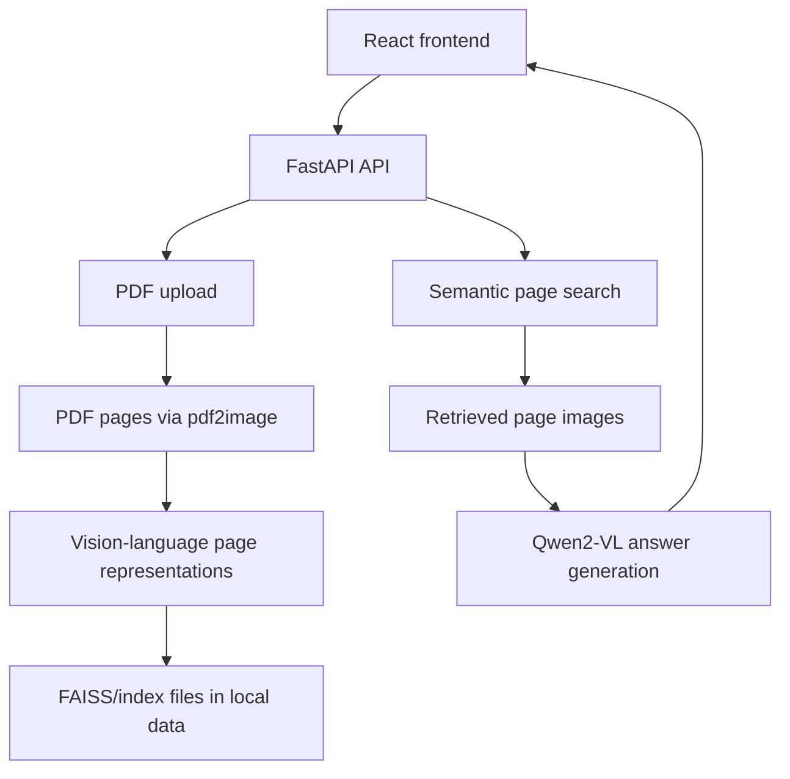

# OCR-Free Multimodal RAG

A local prototype for OCR-free document retrieval and visual question answering
from PDF page images. The current backend uses a Hugging Face vision-language
model to create page representations, FAISS for retrieval, and a FastAPI layer;
the frontend is a React application.

## Status

This checkout is an experimental prototype. The public GitHub repository mapped
to this folder is substantially newer than the local commit, so this working
tree must not be pushed or merged blindly. The local code has no committed
backend lockfile or automated end-to-end evaluation. No production deployment or
accuracy claim is made here.

## Local architecture



See [`docs/ARCHITECTURE.md`](docs/ARCHITECTURE.md) for component boundaries and
local data/privacy notes.

## Technology

- Python, FastAPI, Uvicorn
- PyTorch and Hugging Face Transformers
- FAISS, NumPy, Pillow, and pdf2image
- React, Axios, and Create React App

## Setup

Create a Python environment for the backend and install its dependencies:

```powershell
python -m venv .venv
.venv\Scripts\activate
python -m pip install -r backend/requirements.txt
```

`pdf2image` also requires a working Poppler installation on Windows. The
Transformers model is downloaded from Hugging Face on first use and may require
substantial disk space and GPU/CPU memory. Do not put access tokens, downloaded
model caches, uploaded documents, or generated indexes into Git.

Install the frontend dependencies:

```powershell
cd frontend
npm install
```

## Run

Start the backend from `backend/` so its local imports resolve:

```powershell
cd backend
python -m uvicorn api:app --reload --host 127.0.0.1 --port 8000
```

In another terminal, start the frontend:

```powershell
cd frontend
npm start
```

The current frontend expects the API at `http://127.0.0.1:8000`. Upload a PDF,
wait for indexing, then search or ask a question.

## API surface

- `GET /` — health-style message.
- `GET /documents` — list locally indexed document folders.
- `POST /upload` — save and index a PDF upload.
- `DELETE /documents/{doc_id}` — delete a local indexed document.
- `GET /search?query=...` — retrieve relevant page images.
- `GET /ask?query=...` — generate an answer from the top retrieved page.

These endpoints are intended for local development. The current CORS policy is
permissive and should be restricted before exposing the API to another network.

## Verification

```powershell
python -m py_compile backend/*.py
cd frontend
npm test -- --watchAll=false
npm run build
```

The checks above validate syntax and the frontend build/test harness; they do not
prove retrieval quality, model grounding, or support for every PDF layout.

## Data and security

Local uploads, generated page images, embeddings, FAISS indexes, model caches,
and tokens are private/generated material. Keep them outside commits. The
repository does not include a public dataset license or a production access
control layer.

## License

No license is currently supplied. Confirm the licenses of the source code,
model, downloaded weights, sample documents, and any future public fixtures
before redistribution.
