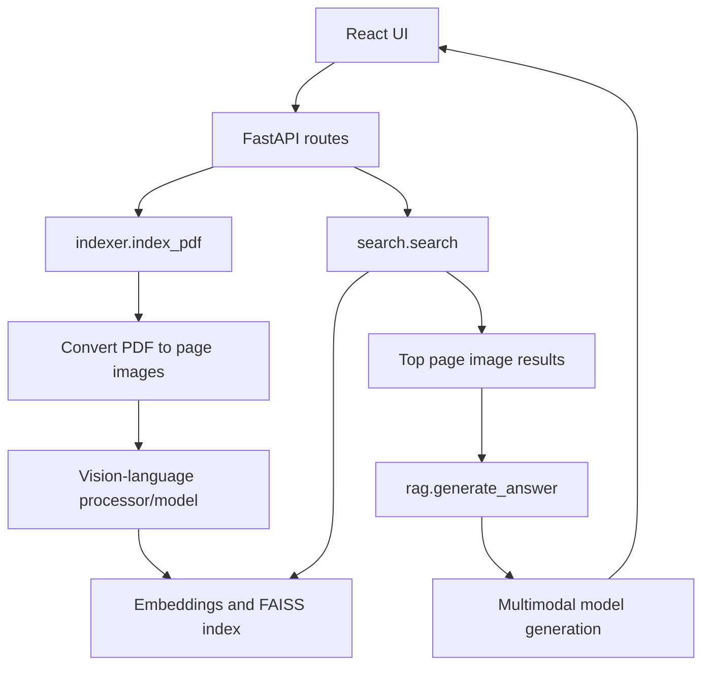

# OCR-Free Multimodal RAG Architecture

## Scope

This document describes the local prototype in this checkout. It does not
describe the newer public remote history, which must be reviewed separately
before any synchronization.

## Components

- `backend/api.py` exposes upload, document listing/deletion, search, and ask
  endpoints. It stores documents beneath local `data/documents/` and serves
  generated page images through a static route.
- `backend/indexer.py` converts uploaded PDF pages to images, prepares model
  representations, and writes local index/embedding artifacts.
- `backend/search.py` loads local index state and returns ranked page hits.
- `backend/rag.py` loads retrieved page images, constructs a multimodal prompt,
  and generates a concise answer with the configured vision-language model.
- `backend/model.py` and `backend/main.py` are model/experiment entry points;
  they should not be treated as independent production services.
- `frontend/` is a Create React App client that calls the local FastAPI server.

## Data flow and storage

PDF bytes are written to a document-specific local directory, converted to page
images, and accompanied by generated embeddings/index data. Search returns local
page paths as HTTP URLs from the backend. The current application has no remote
database, authentication, tenant boundary, retention policy, or encrypted
storage layer.

## Security boundaries

The app is designed for local experimentation. Before a networked deployment,
restrict CORS, add authentication and authorization, validate upload type/size,
prevent path traversal, define document deletion/retention rules, and protect
model/API credentials. Never commit `colpali_token.txt`, uploads, model caches,
private PDFs, or generated indexes.

## External dependencies and operations

The backend requires PyTorch, Transformers, FAISS, pdf2image/Poppler, and model
weights that may be large. The frontend requires Node/npm. No Docker, CI, or
production deployment configuration is present in this checkout.
